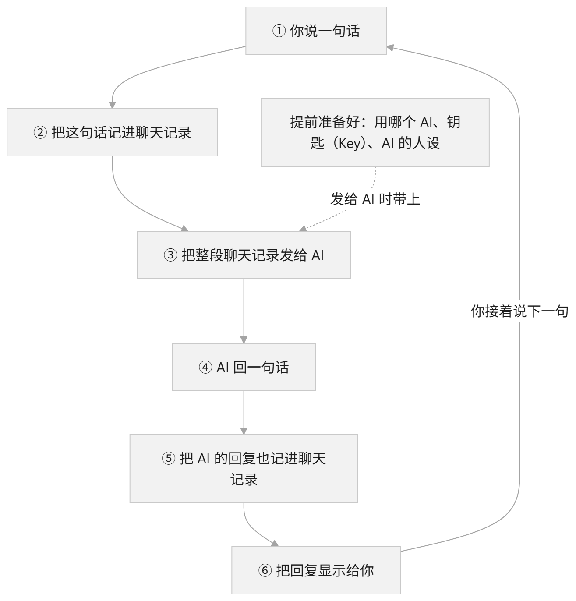
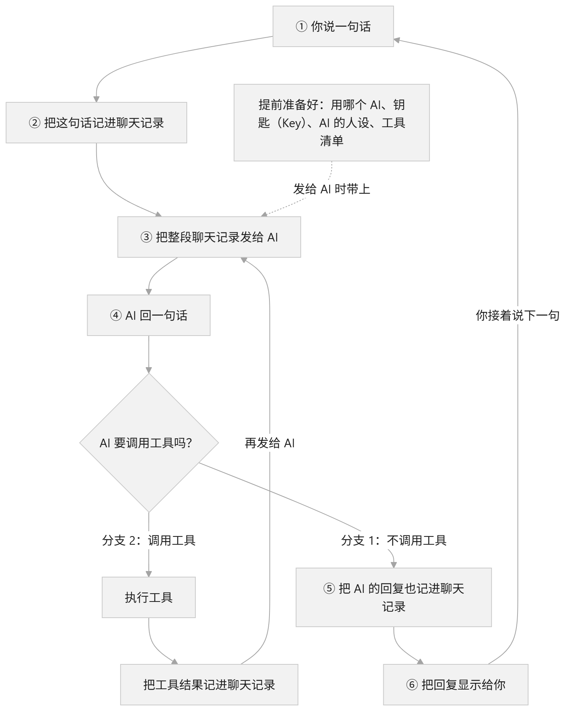

# 用 Java 创建 Agent：先跑通对话循环

# S01、最小Agent循环

## 1、最小对话循环

创建 Agent 的第一步，先让程序能够持续接收输入、请求模型，并带着历史继续对话。

本阶段采用 Java 17 和 OpenAI 兼容接口，只实现文本对话，工具调用后续再加。

核心流程很简单：



**多轮对话的关键是主动传递历史。** 接口返回信息、历史对话信息也作为下次请求的参数。

`核心循环逻辑代码如下：`

```java

        List<ChatMessage> history = new ArrayList<>();
        history.add(new ChatMessage("system", "你是一个友好的助手，请用中文回答。"));
        output.println("对话已启动，输入 exit 或 quit 退出。每行输入发送一次请求。");
        while (true) {
            //获取用户输入
            String line = input.readLine();

            // 使用历史副本发起请求，成功后再用完整问答更新历史。
            List<ChatMessage> request = new ArrayList<>(history);
            request.add(new ChatMessage("user", line));
            //调用API接口
            String answer = client.complete(List.copyOf(request));
            //将返回信息添加到历史对话中
            request.add(new ChatMessage("assistant", answer));
            history = request;
        }

```

这一阶段需要掌握的是：**每轮请求使用历史副本，成功后保存完整问答，失败时保留原历史。**

## 2、调用工具

对话没问题了，然后发现文件中的信息要手动复制粘贴到对话中才行，那么能否让大模型直接读取文件呢？ 能，就是工具调用。

核心流程如下：



细节说明：

1、调用工具是在调用大模型接口后，因为是大模型来决定要不要调用工具。

2、一次会话可能进行多次工具调用，也可能进行多次API调用。

因为在工具调用结果中，可能需要再次调用API接口

然后又因为不可预测性太多了，可能在死循环调用，可能卡死，可能空循环等等，所以需要添加一个最大调用次数限制，超过限制就停止调用。

核心代码逻辑如下：

```java
public void run(BufferedReader input, PrintWriter output) throws IOException {
        List<ChatMessage> history = new ArrayList<>();
        history.add(new ChatMessage("system", "你是一个编程助手，请用中文回答。需要操作或查看环境时使用 shell 工具，"
                + "根据真实工具结果回答。工具错误可修正后再次调用，不要把失败描述为成功。"));
        List<ToolDefinition> definitions = List.of(tool.definition());
        output.println("对话已启动，输入 exit 或 quit 退出。每次输入可触发多次工具调用。");
        output.println("工具> " + tool.definition().description());
        while (true) {
            output.print("你> ");
            output.flush();
            String line = input.readLine();
            if (line == null || "exit".equalsIgnoreCase(line.strip()) || "quit".equalsIgnoreCase(line.strip())) {
                output.println("对话已结束。");
                output.flush();
                return;
            }
            if (StrUtil.isBlank(line)) {
                continue;
            }

            // 首次请求失败仍丢弃本轮；工具执行后保留完整协议历史，操作不能靠丢弃消息撤销。
            List<ChatMessage> request = new ArrayList<>(history);
            request.add(new ChatMessage("user", line));
            boolean toolsRecorded = false;
            try {
                for (int step = 1; step <= maxModelCalls; step++) {
                    ChatMessage answer = client.complete(List.copyOf(request), definitions);
                    request.add(answer);
                    if (StrUtil.isNotBlank(answer.content())) {
                        output.println("助手> " + answer.content());
                    }
                    if (answer.toolCalls().isEmpty()) {
                        history = request;
                        break;
                    }
                    boolean limitReached = step == maxModelCalls;
                    for (ToolCall call : answer.toolCalls()) {
                        output.println("工具请求> " + call.name() + " [" + call.id() + "] " + call.arguments());
                        output.flush();
                        String result = limitReached ? "工具未执行：已达到本轮模型调用上限。"
                                : executeTool(call);
                        request.add(ChatMessage.tool(call.id(), result));
                        output.println("工具结果> [" + call.id() + "] " + result);
                        output.flush();
                    }
                    history = request;
                    toolsRecorded = true;
                    if (limitReached) {
                        String reason = "已达到本轮模型调用上限（" + maxModelCalls + " 次），停止本轮；最后一批工具未执行。";
                        request.add(new ChatMessage("assistant", reason));
                        output.println("助手> " + reason);
                    }
                }
            } catch (HttpTimeoutException e) {
                output.println("请求超时；" + failureHint(toolsRecorded));
            } catch (IOException e) {
                output.println("请求失败：" + e.getMessage() + "；" + failureHint(toolsRecorded));
            } catch (InterruptedException e) {
                Thread.currentThread().interrupt();
                output.println("请求已中断，对话结束。");
                output.flush();
                return;
            }
            output.flush();
        }
    }
```
